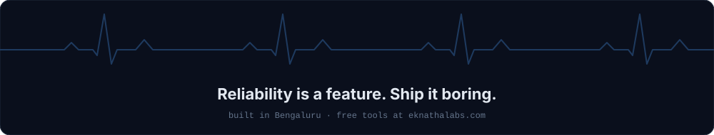

<picture>
  <source media="(prefers-color-scheme: dark)" srcset="./assets/hero-dark.svg">
  <source media="(prefers-color-scheme: light)" srcset="./assets/hero-light.svg">
  
</picture>

  <a href="https://eknathalabs.com"><b>EknathaLabs</b></a> &nbsp;·&nbsp;
  <a href="https://eknathareddy.com"><b>Portfolio</b></a> &nbsp;·&nbsp;
  <a href="https://www.linkedin.com/in/eknathareddypuli"><b>LinkedIn</b></a>

I build and run reliable cloud platforms: Kubernetes, OpenStack, Terraform, hybrid and multi-cloud (AWS + Azure). I also ship free, offline-first tools for Everyone under **EknathaLabs**. No ads, no sign-ups, no tracking.

---

## `kubectl get pods -n eknathalabs`

<picture>
  <source media="(prefers-color-scheme: dark)" srcset="./assets/terminal-dark.svg">
  <source media="(prefers-color-scheme: light)" srcset="./assets/terminal-light.svg">
  
</picture>

| Tool | What it does | |
|---|---|---|
| **KubeDrill** | Kubernetes practice lab | [kubedrill.eknathalabs.com](https://kubedrill.eknathalabs.com) |
| **ChaosLab** | Chaos engineering, beyond Kubernetes | [chaoslab.eknathalabs.com](https://chaoslab.eknathalabs.com) |
| **MARGA** | DevOps, cloud and SRE learning academy | [marga.eknathalabs.com](https://marga.eknathalabs.com) |
| **Bimba** | Offline image toolkit | [bimba.eknathalabs.com](https://bimba.eknathalabs.com) |
| **Resumelytics** | ATS resume analyzer, privacy-first | [resumelytics.eknathalabs.com](https://resumelytics.eknathalabs.com) |
| **Hop by Hop** | Network packet-journey explorer (coming soon) | [hopbyhop.eknathalabs.com](https://hopbyhop.eknathalabs.com) |

---

## Shipping rhythm

<picture>
  <source media="(prefers-color-scheme: dark)" srcset="./assets/pods-dark.svg">
  <source media="(prefers-color-scheme: light)" srcset="./assets/pods-light.svg">
  
</picture>

---

## Production runbooks

Real incident patterns, written down so the next on-call has a head start.

| Repo | Focus |
|---|---|
| [kubernetes-production-runbooks](https://github.com/eknatha/kubernetes-production-runbooks) | Runbooks, troubleshooting and RCA from real incidents |
| [terraform-production-patterns](https://github.com/eknatha/terraform-production-patterns) | Modules, structure, remote state |
| [terraform-playbook](https://github.com/eknatha/terraform-playbook) | Scalable, secure cloud IaC |
| [linux-for-devops](https://github.com/eknatha/linux-for-devops) | Linux commands and troubleshooting for platform engineers |
| [linux-100-devops-challenge](https://github.com/eknatha/linux-100-devops-challenge) | 100 hands-on Linux challenges |

---

## `kubectl rollout history deployment/eknatha`

<picture>
  <source media="(prefers-color-scheme: dark)" srcset="./assets/rollout-dark.svg">
  <source media="(prefers-color-scheme: light)" srcset="./assets/rollout-light.svg">
  
</picture>

---

## Stack

| Layer | Tools |
|---|---|
| Orchestration | Kubernetes · OpenStack · Docker |
| Infrastructure as code | Terraform · Ansible |
| Cloud | AWS · Azure · GCP · hybrid |
| Systems | Linux · virtualization · production support |
| Automation | Python · Shell · GitHub Actions |

<picture>
  <source media="(prefers-color-scheme: dark)" srcset="./assets/footer-dark.svg">
  <source media="(prefers-color-scheme: light)" srcset="./assets/footer-light.svg">
  
</picture>
